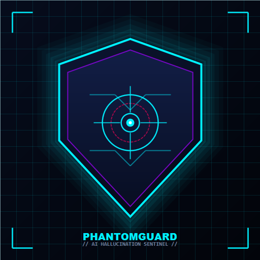

<div align="center">


<br/><br/>



# 🛡️ PHANTOMGUARD
### `[CYBERNETIC SENTINEL // AI HALLUCINATION & SUPPLY-CHAIN RADAR]`

**Real-time interception of AI-hallucinated, malicious, and phantom packages in JavaScript, TypeScript & Python.**

<br/>

[](https://github.com/gitwithmasum/PhantomGuard)
[](LICENSE)
[](https://github.com/gitwithmasum/PhantomGuard)
[-ff0055?style=for-the-badge)](https://cwe.mitre.org)
[](https://github.com/gitwithmasum/PhantomGuard)

<br/>

---

</div>

## 🚨 The Threat: AI Package Hallucination (CWE-1384)

Modern developers write code alongside Large Language Models (**GitHub Copilot, ChatGPT, Claude, Cursor**). While incredibly productive, these models frequently suffer from **Package Hallucination**:

```typescript
// 🚨 Copilot / ChatGPT generated this line:
import { createMagicModal } from 'react-magic-modal-assistant'; // DOES NOT EXIST!
```

Attackers actively monitor LLM hallucination patterns, register these fictitious names on **npm** or **PyPI**, and wait for developers to run:

```bash
npm install react-magic-modal-assistant # 💣 MALICIOUS PAYLOAD EXECUTED
```

**PhantomGuard** is a cybernetic sentinel that operates silently inside VS Code. It intercepts every package import and dependency in real-time, queries official public registries (`registry.npmjs.org` and `pypi.org`), and alerts you before a malicious or fictitious package is ever downloaded.

---

## ⚡ Futuristic Capabilities

```
╔═══════════════════════════════════════════════════════════════════════════════╗
║  [TELEMETRY] PHANTOMGUARD SENTINEL INTERFACE                                  ║
╠═══════════════════════════════════════════════════════════════════════════════╣
║  • Real-Time Interception : Instant registry lookups on JS, TS & Python imports║
║  • Dependency File Guard  : Scans package.json & requirements.txt in real-time║
║  • "Did you mean?" Engine : Smart fuzzy replacement for misspelled packages  ║
║  • Inline Inlay Hints     : Clean status telemetry at the end of each line    ║
║  • Cyber-HUD Hover Card   : Futuristic diagnostics displaying live metrics    ║
║  • Cybernetic Radar       : Full-screen interactive threat monitoring console ║
║  • 1-Click Neutralization : Instant Quick Fix actions to isolate threats      ║
║  • Zero Lag Architecture  : 24hr LRU cache + debounced non-blocking workers   ║
╚═══════════════════════════════════════════════════════════════════════════════╝
```

### 1. 🛡️ Real-Time Hallucination Interception
As you type or paste AI-generated code, PhantomGuard checks whether the package exists on the official registry. Non-existent packages are highlighted with an unmistakable high-contrast cyber-warning.

### 2. 📦 `package.json` & `requirements.txt` Guard
Before you even run `npm install` or `pip install`, PhantomGuard scans all dependencies in `package.json` (`dependencies`, `devDependencies`, `peerDependencies`) and `requirements.txt`. Fictitious packages are flagged right in the file!

### 3. 💡 "Did You Mean?" Smart Replacement
If an AI or developer makes a typo (e.g. `lodsh` or `reqeust`), PhantomGuard computes Levenshtein distance against npm search results and offers a 1-click Quick Fix:
> *💡 `[PhantomGuard] Replace with "lodash" (Did you mean?)`*

### 4. ⚡ Inline Inlay Hints (GitLens-Style Telemetry)
Without needing to hover, clean status indicators appear directly at the end of import lines:
```javascript
import React from 'react';       // ✓ verified • 25.4M/wk
import { x } from 'fake-pkg';    // 🚨 PHANTOM DETECTED
```

### 5. 🛸 Cyberpunk HUD Hover Cards
Hover over any package import to inspect its live registry telemetry:
- **Registry Status:** Verified Active / Non-Existent
- **Weekly Downloads:** Download momentum from npm/PyPI
- **Deprecation Status:** Immediate flags on deprecated libraries
- **Direct Registry Links & Whitelist Triggers**

### 6. 🌐 Cyber-Radar Security Dashboard
Press `Ctrl+Shift+P` and launch `PhantomGuard: Open Cybernetic Radar Dashboard`. Access an interactive, dark neon sci-fi command center featuring:
- Live count of blocked phantoms vs verified clean dependencies
- Full workspace reconnaissance trigger
- Direct whitelist management for private or proprietary company packages

### 7. 🛠️ Automated Quick Fixes (`Ctrl + .`)
When a phantom package is discovered, PhantomGuard provides immediate counter-actions:
- **`Replace`**: Auto-corrects misspelled packages with 1 click.
- **`Neutralize`**: Deletes the hallucinated import line with 1 click.
- **`Annotate`**: Inserts a security annotation comment above the import.
- **`Whitelist`**: Trusts internal or monorepo packages across your workspace.

---

## 🚀 Supported Ecosystems & Languages

| Ecosystem | Registry Source | Supported Languages & Files |
| :--- | :--- | :--- |
| **npm** | `registry.npmjs.org` | JavaScript (`.js`), TypeScript (`.ts`), React (`.jsx`, `.tsx`), `package.json` |
| **PyPI** | `pypi.org` | Python (`.py`), `requirements.txt` |

> *Native built-in modules (`fs`, `path`, `os`, `sys`, etc.) and relative path imports (`./`, `../`, `@/`) are automatically recognized and exempted from registry telemetry.*

---

## ⚙️ Configuration

Customize PhantomGuard via VS Code Settings (`Ctrl + ,` -> search `PhantomGuard`):

```json
{
  // Enable or disable real-time npm verification
  "phantomguard.enableNpm": true,

  // Enable or disable real-time PyPI verification
  "phantomguard.enablePypi": true,

  // Show inline status hints at line ends
  "phantomguard.enableInlayHints": true,

  // Flag packages with < 1,000 weekly downloads as suspicious
  "phantomguard.strictMode": false,

  // List of private/internal packages to always trust
  "phantomguard.whitelist": [
    "@my-org/core-utils",
    "internal-company-sdk"
  ]
}
```

---

## 🎮 Command Palette Shortcuts

| Command | Action |
| :--- | :--- |
| `PhantomGuard: Open Cybernetic Radar Dashboard` | Opens the full-screen sci-fi monitoring HUD |
| `PhantomGuard: Deep Scan Workspace for Hallucinations` | Audits every code file in the project |
| `PhantomGuard: Scan Current File for Phantoms` | Force-rescans active buffer |
| `PhantomGuard: Purge Local Registry Cache` | Flushes local telemetry cache |

---

## 🛠️ Building & Contributing Locally

```bash
# 1. Clone the repository
git clone https://github.com/gitwithmasum/PhantomGuard.git
cd PhantomGuard

# 2. Install dependencies
npm install

# 3. Build with high-speed esbuild bundler
npm run build

# 4. Run tests
npm test
```

Press **`F5`** inside VS Code to launch the **Extension Development Host** and test in real-time.

---

## 📜 Security & Privacy
PhantomGuard strictly makes read-only metadata queries directly to the public **npm** and **PyPI** APIs. No source code, project files, or private variables are ever sent or logged over the network.

---

## 👤 Author & Maintainer

**Masum Billah**  
- GitHub: [@gitwithmasum](https://github.com/gitwithmasum)  
- Email: [sciencefiction844@gmail.com](mailto:sciencefiction844@gmail.com)  
- Repository: [https://github.com/gitwithmasum/PhantomGuard](https://github.com/gitwithmasum/PhantomGuard)

---

<div align="center">
  <sub>Engineered with precision. Defend your codebase against phantom AI dependencies.</sub>
</div>
